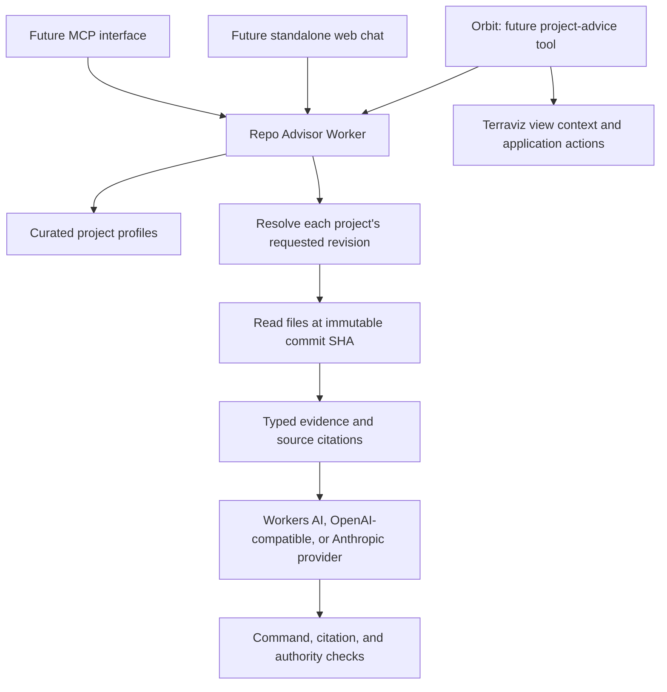

# Architecture

## Responsibilities

The advisor answers project questions using inspectable evidence: supported functionality, usage, troubleshooting, roadmap versus implementation, and contribution opportunities. The answer preview adds bounded source selection, replaceable Workers AI, OpenAI-compatible, and native Anthropic transports, structured output validation, and a frozen-evidence comparison runner. Live model results and remaining access limitations are recorded in the evaluation directory; selecting a default requires both quality review and usable output.

## Source hierarchy

1. For Zyra CLI command and option names, the split capability manifests at the selected revision are authoritative. The index determines canonical domain files and alias ownership.
2. Approved implementation files at that revision provide evidence about behavior and interfaces beyond the manifest. Code inspection is not an execution test; arbitrary test/code browsing is not implemented.
3. Usage documents explain how to use supported behavior. Contribution and governance documents define contribution conventions and integration constraints.
4. Roadmaps and proposals are vision. Their presence cannot establish current capability.
5. Issues and discussions will describe reports, proposals, and ongoing work when the search adapter is implemented. A thread is not proof that a change shipped.

Each configured source has an explicit classification. Both APIs retrieve only configured files, including selected workflow schemas and Orbit interfaces. Arbitrary code browsing, issue search, and discussion search are future work.

## Retrieval and provenance

A request selects a configured project, source ID, and optional branch, tag, or commit. The GitHub adapter resolves the ref through the public commits API and reads all files for that project request from raw GitHub at the resulting 40-character SHA. Citations contain repository, path, commit, immutable GitHub URL, and retrieval time. Two projects require two independently resolved revisions; they do not share a SHA.

There is no persistent cache. A request-scoped cache pins each ref once and reuses immutable file reads throughout planning, generation, and command verification. It never leaks a previous request's ref resolution into a new request. Later persistent caches must key content by repository, commit, and path; mutable ref freshness needs a separate policy. Failures do not fall back to unmarked stale evidence.

For comparison runs, the adapter can capture public file bodies and minimal commit-resolution responses into a snapshot. It captures no request headers or authentication values. Restoring a snapshot makes a closed, offline source adapter: a missing URL fails retrieval, and there is no network fallback. Operator-selected source text remains untrusted even in a snapshot.

Repositories and source paths come from reviewed profiles. A request cannot supply a URL, repository, or arbitrary file path. Manifest-derived domain filenames must be safe JSON basenames. Fetches have time and byte limits and reject redirects. A moved repository therefore requires a reviewed profile update rather than an automatic redirect. The optional GitHub token is sent only to the GitHub API, not to raw content endpoints. Public GitHub limits and outages surface as unavailable evidence.

## Command checks

The CLI source requires an exact manifest command name, without shell arguments. The index selects the stage file; the service finds the requested entry or its canonical alias target and optionally checks named flags. The response includes the complete entry, both source citations, and the canonical command.

`supported` verifies membership and supplied flag names only. Required arguments, values, choices, mutually exclusive groups, prerequisites, and workflow semantics need a later validator. The service never executes a command. Absence is `not_in_manifest` at a particular revision. Invalid JSON, schema drift, authorization errors, rate limits, and missing files are failed verification, not capability gaps.

## Answer-provider boundary

`ModelProvider` in `src/types.ts` defines instructions, question, evidence, a server-defined response schema, cancellation, model identity, generation settings, and optional usage. Workers AI supports a binding or REST transport; the compatible adapter uses an explicitly configured HTTPS Chat Completions endpoint. Native Anthropic uses a fixed Messages endpoint and its own credential, with separate schemas for planning and answers. API schema constraints complement local citation, authority, and command checks. There are no runtime SDK dependencies and no automatic default or fallback provider. See [model configuration](model-providers.md).

An answer request selects one or two configured projects and optional revisions. A bounded English recognizer first handles clear service-policy questions without source or model calls. Conditional cross-project ownership, implementation-plan and publishing-handoff questions use curated source selections and a server-authored review checklist; unavailable contracts fail retrieval. This checklist links relevant sources, asks for missing inputs and gives conditional work/testing steps, but does not validate payloads or assert interoperability. These paths require no provider configuration and expose their version and origin through `generation`; `model` and `settings` are null.

Other questions read their overviews and Zyra's validated CLI index, then make one planning call to select at most eight additional approved sources. For command advice, the planner selects relevant domain catalogs; exact lookups support questions about named commands or flags. All source selections are validated before retrieval. The second call produces an answer with typed claims, evidence IDs, and separate command suggestions. The recognizer is not a general semantic firewall: unrecognized questions still need model review, and compound requests may need separate questions.

Providers see deterministic, bounded line excerpts from documents and up to 24 relevant commands per catalog. Excerpts/catalogs carry omission metadata. Partial content does not establish absence. A 100,000-character input budget bounds serialized prompts; this is a character limit, not a claim about any model's token window.

Before returning an answer, the service validates the JSON contract, citation ID membership, current/planned/gap classifications, and the structure of commands. A proposed command must first appear in retrieved capability evidence, then pass an exact lookup at the same revision. The server renders citation URLs and quotes argument values. Inline executable suggestions and arbitrary links are disallowed in prose. Values, prerequisites, end-to-end workflow semantics, scientific correctness, and whether a passage entails every claim still need review. Prompt instructions are not a formal guarantee against every unsupported statement.

No raw repository text enters the system instruction message. It stays in the JSON data message with the question. No command is executed. Quota, retrieval, and invalid-output failures stop the flow with explicit errors; no unverified draft or fabricated fallback is returned. A request makes at most one planning and one answer call, with no automatic retry. Evaluation of fixed evidence intentionally excludes planning so both providers receive identical generation inputs.

The versioned answer instructions also define the advisor's own read-only service scope and distinguish it from upstream application capabilities. Server-authored service statements and proposed next actions use the existing `uncertain` kind with no fabricated repository citation: here the label means not established by repository evidence, not uncertainty about a server-defined service limit. Model-authored statements remain subject to semantic review. Alias identity comes from the manifest index; absence remains bounded to an exact negative lookup. Prompt-change evaluations require explicit opt-in and retain the original frozen snapshot rather than relabeling its prompt version. Evaluations separate server-owned answers from model calls and guard-pass rates; zero calls mean zero inference tokens/cost, not a model success. Prepared input hashes for a bypassed case are not evidence that the input was sent.

## Orbit integration

Orbit already owns the current dataset, view, time, catalog search, globe controls, and its provider-independent tool loop. Add a focused project-advice contract through that existing loop rather than replacing it. Project questions may pass the deployed software revision and the minimum relevant configuration; ordinary science questions keep using Orbit's existing sources.

Orbit currently scopes its prompt to Earth science. A defined project-help entry point or narrow prompt extension is needed for technical help; appending an unrestricted repository prompt is insufficient. The implementation belongs in Terraviz, obeys its LLM contribution conventions, and remains optional for self-hosted nodes. An unavailable advisor must not break Orbit's existing science conversation or fallbacks.

## Contributions and deployment

Profiles record known contribution sources, templates, and labels. They are guidance metadata, not an implemented drafting or submission flow. Before future drafts, search relevant open and closed issues/discussions; use the selected revision's templates and avoid guessing labels. Zyra workflow-gap drafts include the supported/missing delta, implementation plan, CLI/schema changes, tests, and docs. Terraviz has no templates configured in this foundation; consult its contribution guide and discover current upstream conventions when drafting is added.

The Worker remains for local development. Before public hosting, define per-client budgets, model spend limits, authentication for private surfaces, origin policy, source freshness, and retention. The HTTP service does not persist messages; the explicitly invoked evaluation runner writes source snapshots and model transcripts to operator-selected local files. GitHub writes, running Zyra, and globe actions remain outside the service.

## Inspected upstream contracts

- [Zyra manifest index](https://github.com/NOAA-GSL/zyra/blob/main/src/zyra/wizard/zyra_capabilities/zyra_capabilities_index.json)
- [Zyra existing Open WebUI adapters](https://github.com/NOAA-GSL/zyra/blob/main/llm/open-webui/README.md)
- [Terraviz provider interface](https://github.com/NOAA-GSL/terraviz/blob/main/src/services/llmProvider.ts)
- [Terraviz Orbit tool loop](https://github.com/NOAA-GSL/terraviz/blob/main/src/services/docentService.ts)
- [Terraviz Workers AI proxy](https://github.com/NOAA-GSL/terraviz/blob/main/functions/api/chat/completions.ts)
- [Terraviz LLM contribution conventions](https://github.com/NOAA-GSL/terraviz/blob/main/CONTRIBUTING.md#llm-integrations)

These navigation links follow `main`; actual evidence responses always cite an immutable commit.
