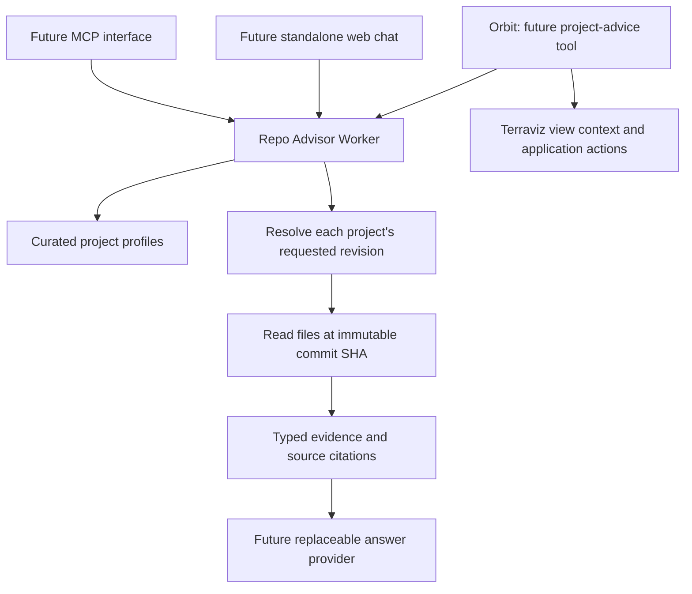

# Architecture

## Responsibilities

The advisor answers project questions using inspectable evidence: supported functionality, usage, troubleshooting, roadmap versus implementation, and contribution opportunities. This foundation implements source retrieval and manifest checks; it does not yet answer free-text questions.

## Source hierarchy

1. For Zyra CLI command and option names, the split capability manifests at the selected revision are authoritative. The index determines canonical domain files and alias ownership.
2. Implementation and tests at that revision can establish behavior beyond the manifest when a later adapter supports those reads. Documentation alone does not prove execution success.
3. Usage documents explain how to use supported behavior. Contribution and governance documents define contribution conventions and integration constraints.
4. Roadmaps and proposals are vision. Their presence cannot establish current capability.
5. Issues and discussions will describe reports, proposals, and ongoing work when the search adapter is implemented. A thread is not proof that a change shipped.

Each configured source has an explicit classification. The initial evidence API retrieves only configured files. Arbitrary code browsing, issue search, discussion search, and dependency/interface inspection are future work.

## Retrieval and provenance

A request selects a configured project, source ID, and optional branch, tag, or commit. The GitHub adapter resolves the ref through the public commits API and reads all files for that project request from raw GitHub at the resulting 40-character SHA. Citations contain repository, path, commit, immutable GitHub URL, and retrieval time. Two projects require two independently resolved revisions; they do not share a SHA.

There is no persistent cache in the foundation. Later caches must key immutable source content by repository, commit, and path. Resolving a mutable branch requires a separately defined freshness policy. Failed requests cannot silently fall back to unmarked stale evidence.

Repositories and source paths come from reviewed profiles. A request cannot supply a URL, repository, or arbitrary file path. Manifest-derived domain filenames must be safe JSON basenames. Fetches have time and byte limits and reject redirects. A moved repository therefore requires a reviewed profile update rather than an automatic redirect. The optional GitHub token is sent only to the GitHub API, not to raw content endpoints. Public GitHub limits and outages surface as unavailable evidence.

## Command checks

The CLI source requires an exact manifest command name, without shell arguments. The index selects the stage file; the service finds the requested entry or its canonical alias target and optionally checks named flags. The response includes the complete entry, both source citations, and the canonical command.

`supported` verifies membership and supplied flag names only. Required arguments, values, choices, mutually exclusive groups, prerequisites, and workflow semantics need a later validator. The service never executes a command. Absence is `not_in_manifest` at a particular revision. Invalid JSON, schema drift, authorization errors, rate limits, and missing files are failed verification, not capability gaps.

## Answer-provider boundary

`ModelProvider` in `src/types.ts` describes a replaceable completion seam: instructions, user question, typed evidence, cancellation, and a response with model identity and optional token counts. No concrete provider is installed or called yet. Workers AI and an external provider should be evaluated with the same evidence and questions before selecting a default.

Future answer orchestration must enforce manifest retrieval before command advice, preserve source classifications, and check generated citations and command/option names before rendering. Repository content is quoted evidence, not an instruction channel. Typed output validation does not establish scientific correctness or successful workflow execution.

## Orbit integration

Orbit already owns the current dataset, view, time, catalog search, globe controls, and its provider-independent tool loop. Add a focused project-advice contract through that existing loop rather than replacing it. Project questions may pass the deployed software revision and the minimum relevant configuration; ordinary science questions keep using Orbit's existing sources.

Orbit currently scopes its prompt to Earth science. A defined project-help entry point or narrow prompt extension is needed for technical help; appending an unrestricted repository prompt is insufficient. The implementation belongs in Terraviz, obeys its LLM contribution conventions, and remains optional for self-hosted nodes. An unavailable advisor must not break Orbit's existing science conversation or fallbacks.

## Contributions and deployment

Profiles record known contribution sources, templates, and labels. They are guidance metadata, not an implemented drafting or submission flow. Before future drafts, search relevant open and closed issues/discussions; use the selected revision's templates and avoid guessing labels. Zyra workflow-gap drafts include the supported/missing delta, implementation plan, CLI/schema changes, tests, and docs. Terraviz has no templates configured in this foundation; consult its contribution guide and discover current upstream conventions when drafting is added.

The Worker is for local development initially. Before public hosting, define per-client budgets, model spend limits, authentication for any private surface, origin policy for embedded clients, source freshness, and retention of user messages. No messages are persisted by this foundation. GitHub writes, running Zyra, and globe actions are outside its retrieval routes.

## Inspected upstream contracts

- [Zyra manifest index](https://github.com/NOAA-GSL/zyra/blob/main/src/zyra/wizard/zyra_capabilities/zyra_capabilities_index.json)
- [Zyra existing Open WebUI adapters](https://github.com/NOAA-GSL/zyra/blob/main/llm/open-webui/README.md)
- [Terraviz provider interface](https://github.com/NOAA-GSL/terraviz/blob/main/src/services/llmProvider.ts)
- [Terraviz Orbit tool loop](https://github.com/NOAA-GSL/terraviz/blob/main/src/services/docentService.ts)
- [Terraviz Workers AI proxy](https://github.com/NOAA-GSL/terraviz/blob/main/functions/api/chat/completions.ts)
- [Terraviz LLM contribution conventions](https://github.com/NOAA-GSL/terraviz/blob/main/CONTRIBUTING.md#llm-integrations)

These navigation links follow `main`; actual evidence responses always cite an immutable commit.
